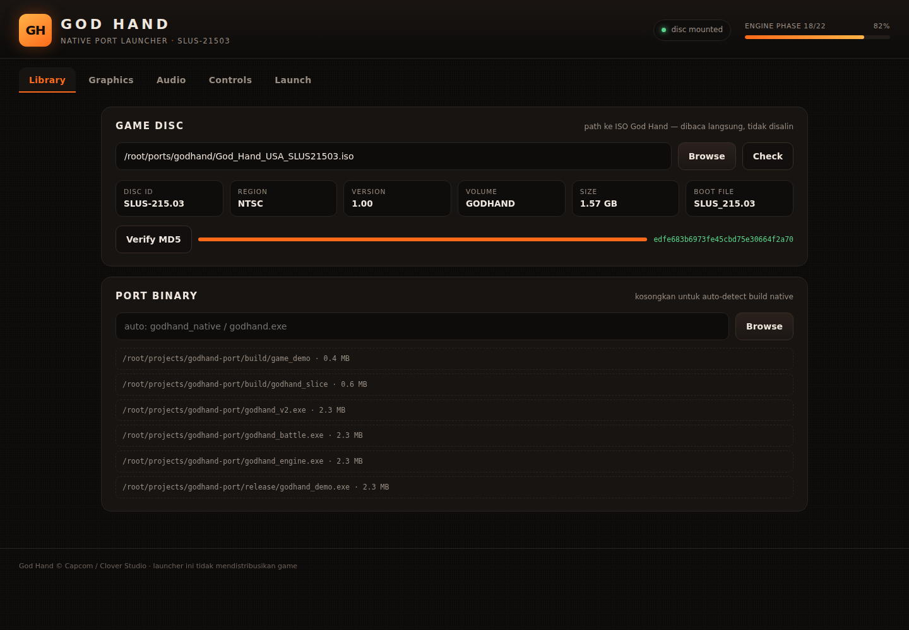

# God Hand Launcher

GUI launcher untuk God Hand native port (SLUS-21503). Pilih ISO, atur grafis sampai 4K,
map gamepad & keyboard, lalu tekan PLAY.



## Jalanin

```bash
python3 launcher.py            # buka window app-mode (chromium/edge) + server
python3 launcher.py --no-window # server saja, buka manual di browser
```

Windows: dobel-klik `start.bat` (butuh Python 3.10+, stdlib saja — tanpa pip install).

## Fitur

- **ISO manager** — path picker + validasi nyata: baca ISO9660 PVD sector 16, cari
  `BOOT2 = cdrom0:\SLUS_215.03;1`, ekstrak disc ID / region / version / volume label.
  Salah file langsung ditolak dengan alasan. MD5 verify on-demand (progress bar).
- **Graphics** — renderer (Vulkan/D3D12/OpenGL/Software), resolusi 720p→4K + custom,
  window/borderless/fullscreen, internal scale 1×–4× (supersampling), MSAA 1–8×,
  anisotropi 1–16×, texture filter linear/nearest, V-Sync, FPS cap 60/120/144/uncapped,
  widescreen hack, frame skip.
- **Audio** — master/BGM/SFX slider, backend auto/WASAPI/ASIO/null, voice EN/JP.
- **Controls** — 12 aksi, remap keyboard dengan capture tombol langsung, gamepad
  auto-detect via Gamepad API (nama device + jumlah tombol), remap per tombol dengan
  "press…", deadzone slider, vibration toggle.
- **Engine status** — parsing `PROJECT.md` live: phase selesai/total, milestone berikutnya,
  daftar binary hasil build. PLAY aktif otomatis begitu binary native muncul.
- **Diagnostics** — tombol run `crt0_test` (5M inst cap) dan lihat output mentah di console.

## Config

`~/.config/godhand-launcher/config.json` (override: `GH_LAUNCHER_HOME`).
Semua perubahan tersimpan otomatis, debounce 120 ms.

Env override: `GH_PORT_ROOT` (default `/root/ports/godhand`), `GH_REPO`
(default `/root/projects/godhand-port`).

## Kontrak argumen engine

Lihat `CONTRACT.md` — launcher memanggil binary port dengan flag tetap; engine wajib
menerima flag itu supaya setting GUI benar-benar kepakai.

## Catatan

- PLAY sengaja **tidak** fallback ke emulator. Kalau binary native belum ada, launcher
  melaporkan fase yang sedang dikerjakan, bukan pura-pura jalan.
- ISO tidak pernah disalin/dimodifikasi — dibuka read-only.
- Launcher ini tidak mendistribusikan game; butuh ISO milik sendiri.
